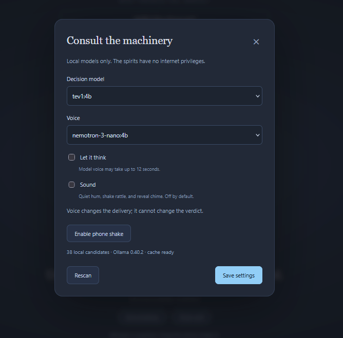
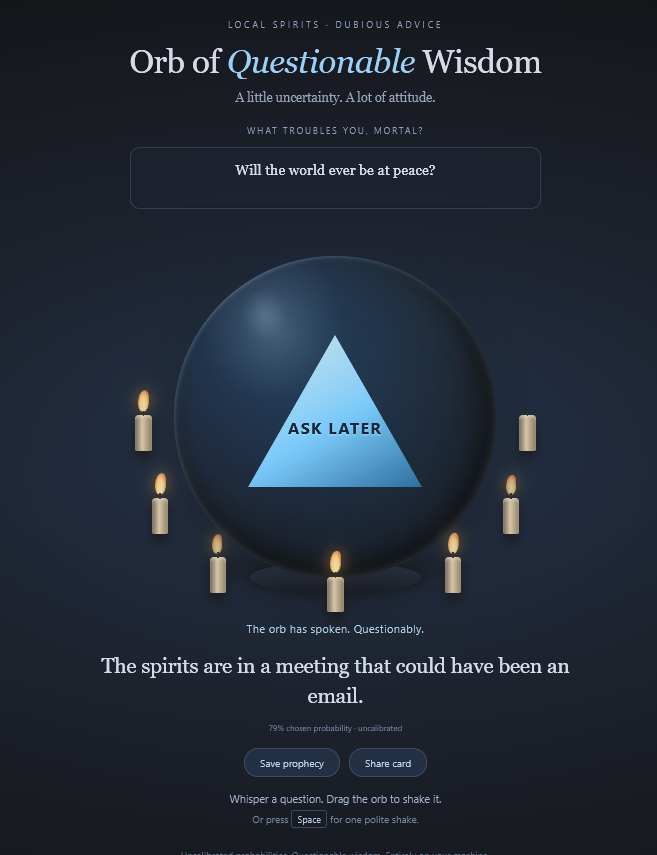
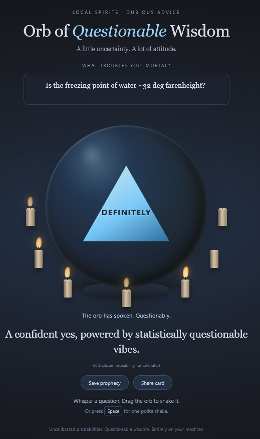

# Orb of Questionable Wisdom

A 'magical orb' powered by local Ollama models. Ask a question, shake the orb, and receive statistically questionable advice.

## Windows setup

1. Install [Python 3.11+](https://www.python.org/downloads/windows/) and enable **Add Python to PATH**.
2. Install and start [Ollama 0.35+](https://ollama.com/download/windows).
3. Download the project ZIP and extract it to a folder you can write to.
4. Double-click **install.bat**; accept the optional local decision-model download, or run the printed `ollama pull` command later.
5. Double-click **start.bat**; the orb opens in your browser at `http://127.0.0.1:8768`.
6. Type a question, then drag the orb or focus it and press **Space**; keep the server terminal open.
7. Use the gear to select local models; Nemotron Nano is the default voice, with canned fallback.

The installer creates `.venv`, installs pinned Python dependencies, checks Ollama, and generates the launcher. Rerunning it preserves your settings and local data. Model downloads require your choice and may be several GB.

## What is available

The current P2 version includes the single-orb loop, settings, background discovery, prewarming, generated or canned voice, reduced motion, and labeled dice fallback. Seven confidence candles surround a larger floating orb with drifting murk. A seance reveal, optional local sound, and PNG share cards are available. The prophecy ledger, additional modes, and persona selection remain for later phases.

Decision models use `/v1/systemone`; voice models use `/api/chat`. The configured default oracle is `tev1:4b`; the selectable default voice is `nemotron-3-nano:4b`. Choose another installed local chat model or canned quips in settings. A slow or invalid voice response falls back to a canned line without delaying the reveal.

## Models on Ollama

Browse [Ollama's decision models, newest first](https://ollama.com/search?c=decision&o=newest) for the oracle role. Install a local decision model, then use **Rescan** in settings and select it. The orb discovers candidates and checks `/v1/systemone` compatibility in the background.

The screenshots below use [TEV1 4B](https://ollama.com/library/tev1) for decisions and [Nemotron 3 Nano 4B](https://ollama.com/library/nemotron-3-nano) for voice:

```bat
ollama pull tev1:4b
ollama pull nemotron-3-nano:4b
```

Both roles remain selectable. TEV1 also has a smaller `tev1:0.8b` variant. Nemotron handles the delivery, while the decision model selects the verdict and probabilities.

## How to read an omen

The selected decision model makes its own judgment from your question and the available context. Its interpretation gives the orb its character: changing decision models can change the verdict and confidence. Nemotron supplies the voice; it cannot change the chosen verdict.

“ASK LATER” is a legitimate judgment when the model finds insufficient evidence or no matching answer. Questions about an unknown future may receive it often—even confidently. The orb preserves that judgment instead of forcing a more entertaining answer.

For variety, an ASK LATER reveal randomly reads **THE MISTS REFUSE**, **NOT YET, MORTAL**, **OMEN PENDING**, **THE SPIRITS ABSTAIN**, **INSUFFICIENT OMENS**, or **FATE IS UNDECIDED**. These are display labels for the same verdict; hover over the triangle to see the original oracle verdict. Its probabilities and voice prompt remain unchanged, and the share card keeps the same reveal label with the original verdict noted below.

Every verdict has a group of equivalent reveal labels:

| Oracle verdict | Reveal labels |
| --- | --- |
| DEFINITELY | DEFINITELY · THE OMENS AGREE · SO IT SHALL BE · A CERTAIN YES |
| PROBABLY | PROBABLY · THE OMENS LEAN YES · A LIKELY YES · FATE LOOKS FAVORABLE |
| ASK LATER | THE MISTS REFUSE · NOT YET, MORTAL · OMEN PENDING · THE SPIRITS ABSTAIN · INSUFFICIENT OMENS · FATE IS UNDECIDED |
| UNLIKELY | UNLIKELY · THE OMENS LEAN NO · A DOUBTFUL SIGN · FATE LOOKS UNFAVORABLE |
| NO | NO · THE OMENS SAY NO · THE WAY IS CLOSED · A CERTAIN NO |
| CURSED | CURSED · AN ILL OMEN · DOOM APPROACHES · BEWARE, MORTAL |

Hover over the quip to see its actual voice source: the generating model name or **Voice: canned fallback**. Keyboard users can focus the quip to hear this source description. The voice model gets its own three-second window after the oracle finishes, including at most one retry. The 1.5-second theatrical delay is a minimum and does not consume that voice window. “Let it think” allows up to 12 seconds instead. Selecting Nemotron does not guarantee that every line was generated: slow, missing, failed, or invalid voice responses use a canned line.

Candles show the probability assigned to the **chosen verdict**, including “ASK LATER”: lit count is rounded from probability × 7. More candles mean stronger model confidence in that verdict, not a more positive answer. These probabilities are uncalibrated and do not establish real-world accuracy. Shake strength changes the theatrics only; it never changes the verdict.

## Screenshots

### Local model settings



### An uncertain future: ASK LATER



### A factual question: DEFINITELY



## Privacy

Questions and inference stay on your machine. The server binds to `127.0.0.1`, cloud models are excluded, and the page has no telemetry, CDN, or external assets. Setup downloads Python packages and any models you explicitly approve. Settings/cache live in `data/orb.db`; they are excluded from the downloadable release.

Probabilities are **uncalibrated**. This is a toy, and its confidence does not measure real-world accuracy.

## Development

Install `requirements-dev.txt` for browser checks; `python -m unittest test_core test_install -v` runs the isolated behavior checks. `python build_release.py` creates a release ZIP from an explicit file list and scans its contents for credentials and personal paths. It excludes environments, databases, logs, test captures, and model benchmark reports. Local model integration checks are separate from the isolated tests.
